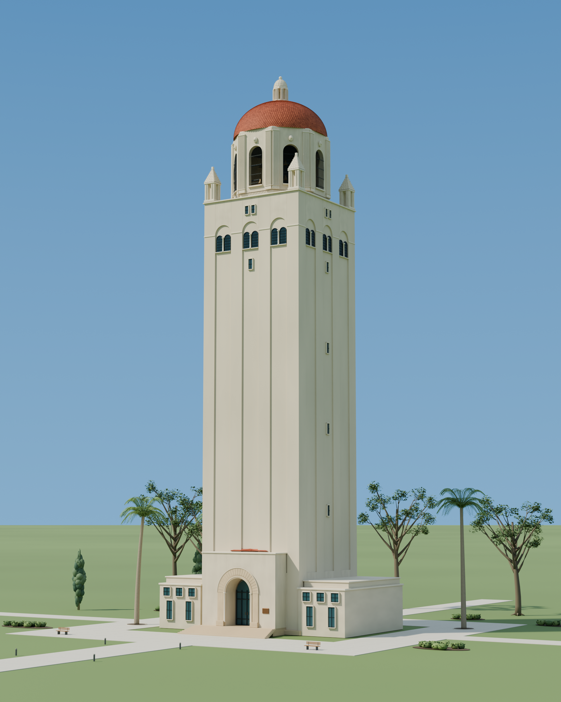
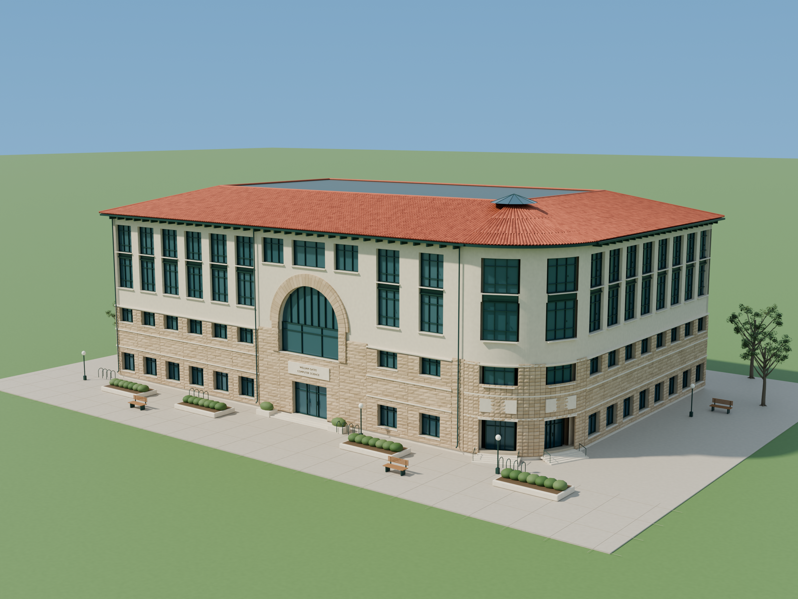
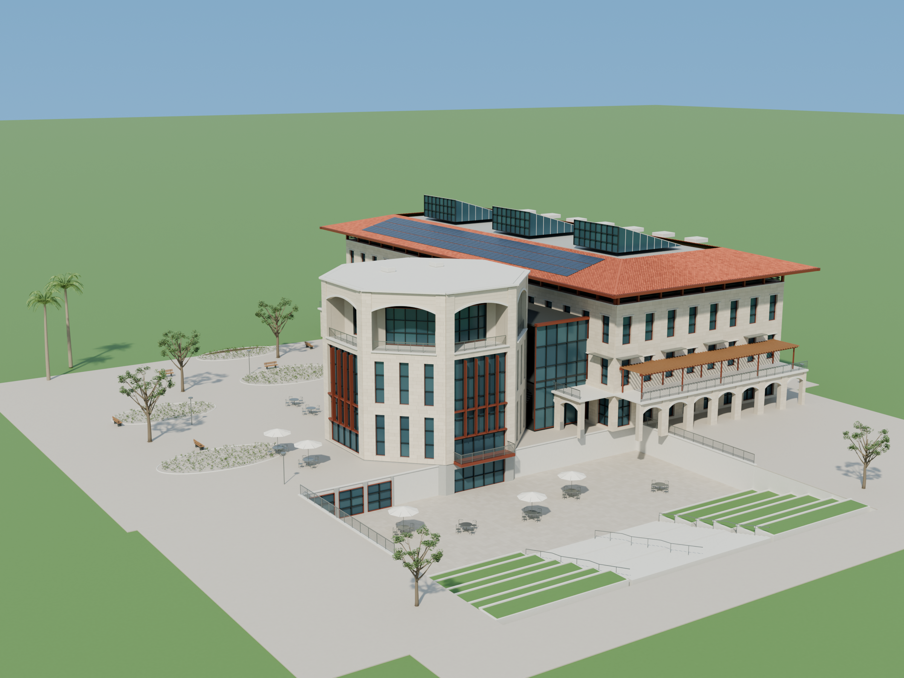
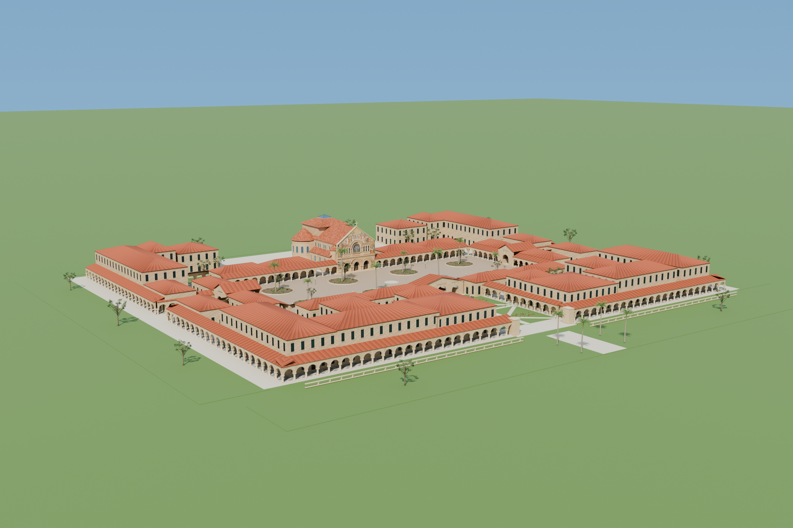
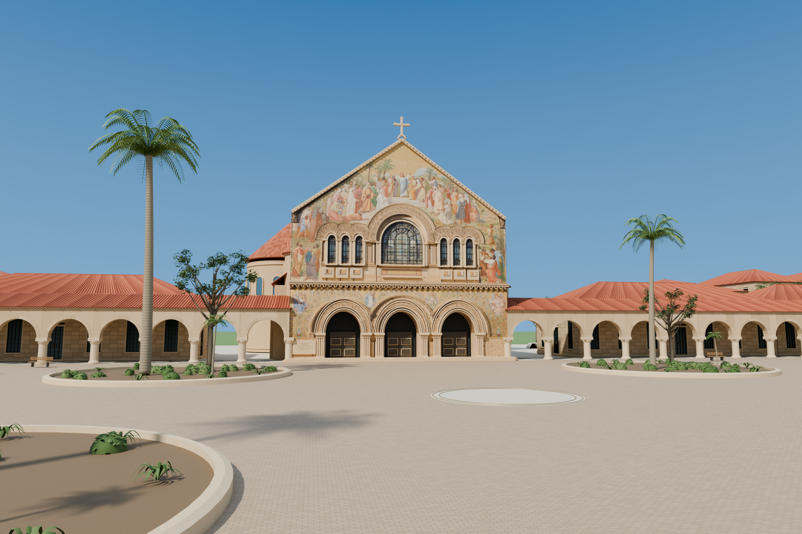

# Stanford in Blender

Four editable Stanford campus models, built with **GPT-6 Astra** in Blender.
A small gift to a place that means a lot to me.

Download the scenes, explore them, change the lighting, or rebuild them from the
Python source. Each `.blend` opens on its own: materials, cameras, lighting and
any required image texture are included.



## Download the Blender files

The ready-to-open models live in [GitHub Releases](https://github.com/minsik-ai/stanford-in-blender/releases/latest).
These are direct downloads, one file per model:

| Model | Download | Preview |
| --- | --- | --- |
| Hoover Tower | [Hoover_Tower_Stanford.blend](https://github.com/minsik-ai/stanford-in-blender/releases/download/v1.0.0/Hoover_Tower_Stanford.blend) | [Hero](renders/hoover_hero.png) · [Crown](renders/hoover_crown.png) |
| Gates Computer Science Building | [Gates_Computer_Science_Stanford.blend](https://github.com/minsik-ai/stanford-in-blender/releases/download/v1.0.0/Gates_Computer_Science_Stanford.blend) | [Hero](renders/gates_hero.png) |
| Jen-Hsun Huang Engineering Center | [Huang_Engineering_Center_Stanford.blend](https://github.com/minsik-ai/stanford-in-blender/releases/download/v1.0.0/Huang_Engineering_Center_Stanford.blend) | [Hero](renders/huang_hero.png) |
| Main Quad and Memorial Church | [Main_Quad_Stanford.blend](https://github.com/minsik-ai/stanford-in-blender/releases/download/v1.0.0/Main_Quad_Stanford.blend) | [Overview](renders/main_quad_overview.png) · [Courtyard](renders/main_quad_courtyard.png) |

## Gallery

### Gates Computer Science Building


### Jen-Hsun Huang Engineering Center


### Main Quad and Memorial Church



The Memorial Church facade uses a photograph by **King of Hearts**,
[CC BY-SA 3.0](https://commons.wikimedia.org/wiki/File:Stanford_Memorial_Church_May_2011_002.jpg),
UV-mapped onto the modeled facade. See [CREDITS.md](CREDITS.md).

## Viewing

Created and tested with **Blender 5.2.2 LTS**. Earlier versions have not been
verified. No AI service, MCP server, Python package installation, or add-on is
needed to open the downloaded scenes.

- The saved Material Preview uses the scene's world and lights, so the sky and
  materials are visible when the file opens.
- For the full Cycles lighting in the viewport, press **Z → Rendered**.
- Use **Render → Render Image** for a finished image from the active camera.
- Other named cameras are included for alternate views.

Blender resets a saved Rendered viewport to Solid on reopening; scene-lit
Material Preview is used as the persistent default.

## Rebuild from source

Use Blender's bundled Python runtime. From the repository root:

```sh
blender --background --factory-startup --python-exit-code 1 --python build.py -- all --verify
```

Or build one scene:

```sh
blender --background --factory-startup --python build.py -- hoover
blender --background --factory-startup --python build.py -- gates
blender --background --factory-startup --python build.py -- huang
blender --background --factory-startup --python build.py -- quad
```

On macOS, the Blender executable is usually
`/Applications/Blender.app/Contents/MacOS/Blender`.

The other scenes reuse original procedural trees from the Hoover scene. The
build entry point creates Hoover first if that asset source is absent. Generated
`.blend` files are written to the repository root and are ignored by Git.

The `scripts/` directory contains the procedural geometry and refinement stages.
`references/` contains source ledgers and the one licensed texture needed to
rebuild Memorial Church. The rendered previews are in `renders/`.

## Scope and accuracy

These are artistic, photo-informed reconstructions. Building dimensions,
less-visible facades, small carved details, planting and some site arrangements
are approximate. They are intended for exploration and illustration, not for
construction, surveying or historical documentation. Geometry and materials are
editable, with model parts organized into collections.

## License

- **Build scripts:** [MIT](LICENSE).
- **Blender models and renders:** [CC BY-SA 3.0](ASSET_LICENSE.md).
- **Memorial Church photograph:** King of Hearts, CC BY-SA 3.0; retain the
  [included attribution](CREDITS.md).

This is an independent project and is not an official Stanford University release.
